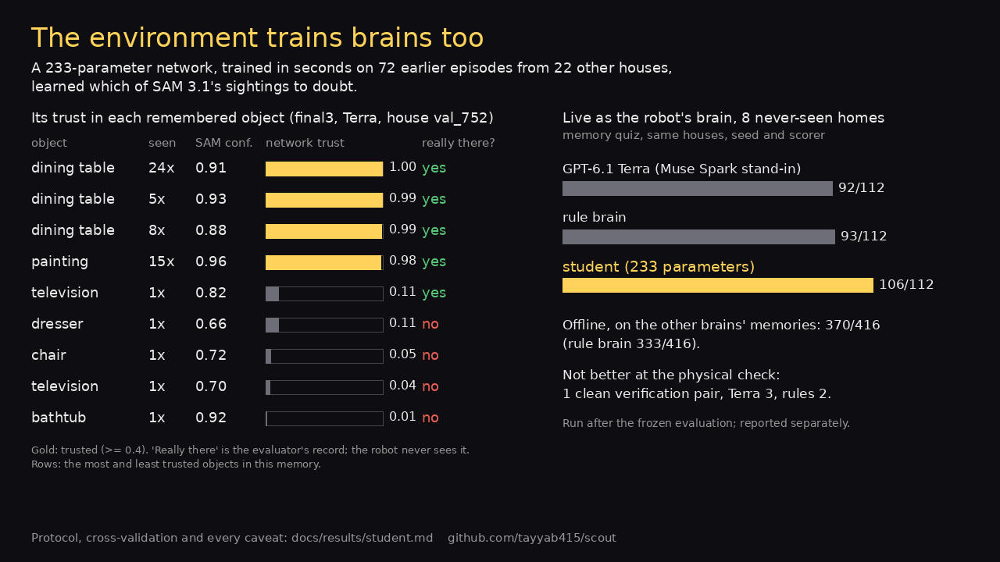

# Scout

### A physics-simulated home that tests whether a robot's memory is still true.


A Meta Motivo humanoid explores a house it has never seen. It sees through a head camera with SAM 3.1 and keeps a
memory of what it saw and where. Then the episode splits into two worlds. In one, nothing changes. In the other, we
quietly move an object. Both copies of the robot get the same question: *"Is the sofa you saw at 232 s still where
it was?"*


**Memory can't tell the two worlds apart. Looking can.** Answering from memory says "still there" in both worlds,
so it is wrong in one of them. The robot that walks back and looks gets both right: its depth camera now sees past
the spot where the sofa was.

**Scout gives robots a new capability: knowing when their memory has gone stale, and going back to check.** It is
an open, physics-simulated proving ground where three Meta models run in one closed loop: Meta Motivo moves the body,
SAM 3.1 sees, and Llama 4 Maverick is one of the brains put to the test. Any model plugs in through four methods.
Scout runs the physics, the eyes and the hidden interventions, then grades every answer against what the robot's
camera actually saw, frame by frame.

**It also trains brains.** A 233-parameter neural network, trained in seconds on Scout's own episodes, took over
the robot's head and out-remembered Muse Spark 1.3 in eight never-seen homes: 106 of 112 against 92.
[See the network](#the-neural-network-we-trained).

- **Real physics, not animation.** A Meta Motivo humanoid in MuJoCo walks, turns to look, falls and gets itself
  back up: 35 falls and 35 recoveries in the final evaluation.
- **It sees for itself.** SAM 3.1 open-vocabulary masks on an RGB-D head camera, lifted into 3D, and a floor map
  built from its own depth. No layout, no object list, no shortcuts.
- **A world that changes behind its back.** Each episode branches from one physics snapshot into a moved world and
  an unchanged world, so both copies of the robot face the identical question.
- **Scoring that is hard to fool.** Every answer is graded against per-frame visibility, every cited frame is
  checked against the evaluator's segmentation, abstentions are counted separately, and every failure is kept.
  Anyone can rescore all 32 final episodes from the public records on a laptop.

### Why it matters

Every robot and assistant that remembers the physical world falls into the same trap. A home robot asked "where
are my keys?", a care robot making sure the walker is still by the bed, AI glasses recalling where you left your
bag: each answers from a memory that may no longer be true. Scout makes that failure measurable, comparable across
models and trainable: the data it produces already trains better brains.

| Part | Model / asset | Role |
| --- | --- | --- |
| Body | Meta Motivo M-1 (FB-CPR), SMPL humanoid in MuJoCo | walks, falls, gets back up |
| Eyes | SAM 3.1 (open weights, `facebook/sam3.1`) | open-vocabulary object masks on the head camera |
| Brain under test | Llama 4 Maverick, Muse Spark 1.3 (Meta Model API), rules, random, and a 233-parameter neural network trained on Scout's own episodes | when to re-check; which object a question is about; the answers |
| Worlds | ProcTHOR-10K houses from MolmoSpaces (CC BY 4.0), 800 train / 200 test | unseen homes |

## Built during the hackathon (Oct 27 - Nov 4, 2026)

The models and houses above were not built here. Everything else was.

- The body controller: blended Motivo skill vectors and fall recovery.
- The head RGB-D camera, and the floor map the agent builds from its own depth.
- SAM 3.1 placement of detections in 3D, and the episodic memory with confident and tentative objects.
- The brain interface.
- The evaluator: stable object ids, per-frame visibility, hidden interventions.
- The branched moved / unchanged episodes, the scorers, and the synchronised video renderer.
- The student: a 233-parameter neural network trained in seconds, on CPU, from the episodes the environment exports
  (`src/scout/student/`, added 4 November).

## What the agent gets (observation contract)

- **Head RGB-D:** 512×512, 75° vertical FOV, tilted 20° down. Depth is ideal simulated depth.
- **Pose:** the exact head-camera pose, and the body's position, heading and head height. This is perfect odometry
  from the simulator, and it is disclosed.
- **Detections:** SAM 3.1 detections for 16 object categories, once per second.
- **Actions:** Motivo skill vectors at 30 Hz. The built-in controller turns waypoints into skill blends.
- **The agent never sees:** the house layout, room labels, the object list, or any evaluator intervention.

Exploration uses a fixed rule (nearest reachable frontier on the agent's own map) for every brain. Brains decide
re-checks and answer questions. See `docs/environment.md` for the API, the tasks and the scoring rules.

## Run it

Full setup from scratch is in `docs/setup.md`: accounts, the house download, skill vectors and every command.

```bash
uv venv && uv pip install -e . modal boto3 pytest pillow "imageio[ffmpeg]"
.venv/bin/python -m pytest -q tests                      # CPU only: 81 tests, including six rounds of independent review
python scripts/quiz_offline.py records                   # the memory quiz answered offline by any brain, scored by the environment
python scripts/train_student.py --records <dev runs> --exclude-houses configs/frozen_final3.json   # retrain the student
# score a real recorded episode without a GPU: see docs/setup.md section 5 (examples/sample_episode)
modal run scripts/modal_env.py::episode --house procthor-10k-val_val_935 --brain rules     # one episode, both arms (GPU)
modal run scripts/modal_env.py::compare --houses-file final2_houses.json --tag mytag      # frozen brain comparison
modal run scripts/modal_env.py::score --tag mytag                                        # leaderboard
modal run scripts/modal_env.py::videos --tag mytag                                       # synchronised videos
```

## License

MIT for this code; see `THIRD_PARTY.md` for the models and data (Meta Motivo is CC BY-NC 4.0).

## Results (final evaluation: 8 never-seen homes × 4 brains, 32 of 32 episodes)

- **Six clean verification pairs out of 32 episodes.** In each, the robot walked back, looked, and answered
  correctly in both worlds, while the memory-persistence rule was wrong in the moved one.
- **All 64 verification arms, counted:** 16 correct, 10 abstained, 16 wrong target (mostly the random brain),
  8 no answer in time, 14 not run (no eligible target). No arm checked the right object and gave the wrong
  verdict.
- **The memory-persistence rule was never right when the object had moved** (0 for every brain). The rule answers
  from memory without looking and calls no model, so this shows the stale-memory trap, not a model's judgement.
- **The memory quiz separates the brains.** It is graded only against what each robot's camera actually saw:
  - Muse Spark 1.3 (Meta Model API): 92/112 correct;
  - rules: 93/112;
  - Llama 4 Maverick: 48/96, with 16 invalid replies;
  - random: 16/96.
- **The body stays up:** 35 falls, and it got itself back up all 35 times.

## The neural network we trained



Scout is not only a test. Every episode it runs becomes training data: the memory the robot built, paired with the
evaluator's ground truth about what was really there. We used that data to train a tiny neural network, dropped it
into the robot's head, and sent it into eight homes it had never seen. **It out-remembered a frontier LLM.**

### What it is

A **233-parameter neural network**. That is not a typo: 233 weights, against the billions in the language models it
competes with. A two-layer perceptron in plain numpy (27 inputs, 8 tanh units, 1 sigmoid output,
`src/scout/student/trust.py`, weights in `assets/brains/student_trust.npz`). It reads one line of the robot's memory
and answers one question: *is this object really there, or did the eyes imagine it?*

- **It sees what every brain sees, and nothing more:** the memory table. Times seen, SAM 3.1 confidence, time span,
  time since last seen, misses, retractions, how many objects share a label, the category, and a few more counts
  (all 27 in `FEATURE_NAMES`). No positions, no frames, no access to the ground truth.
- **It learned from Scout's own referee:** an object counts as real only if the evaluator confirms it was in view
  (at least 0.5% of a captured frame) within 1.5 m of where the robot remembers it.
- **It runs the whole brain:** it answers the memory quiz, decides which object a question is about, and chooses
  what to walk back and re-check: the object it is least sure of.

### How we trained it

- **Data:** 72 episodes from 22 houses, 1,985 remembered objects, all exported by Scout itself. The eight
  final-evaluation homes were walled off from training, and a test (`tests/test_student.py`) enforces it.
- **Compute:** a few seconds on a laptop CPU. No GPU, no pretraining, no API calls.
- **Validation:** leave-one-house-out cross-validation picked the settings. On held-out houses it reaches 0.781
  accuracy, against 0.680 for blindly trusting everything.
- **What it discovered on its own:** SAM 3.1's blind spots. It learned to trust dining tables and paintings, to doubt
  bathtubs, chairs and televisions, and to drop objects the robot keeps failing to find again.

```bash
python scripts/train_student.py --records <dev runs> --exclude-houses configs/frozen_final3.json
```

### Results

Live, as the robot's only brain, in the same eight never-seen homes as the final evaluation, same seed and budgets:

| live, same 8 never-seen homes | memory quiz |
|---|---:|
| **neural network (233 parameters, trained here)** | **106/112** |
| rules | 93/112 |
| Muse Spark 1.3 (Meta Model API) | 92/112 |
| Llama 4 Maverick | 48/96 |
| random | 16/96 |

**First place out of five, ahead of a frontier LLM, with 233 parameters and seconds of training.** It also wins
offline: handed the memories the other brains built, it answers 370 of 416 questions correctly, against 333 for the
hand-written rules.

This is what Scout is for. The environment that grades a robot's memory also produces the data to build a better
one.

Full run, every outcome: `docs/results/final3_student/leaderboard.md`. Training, cross-validation and ablations:
`docs/results/student.md`.

Full leaderboard, every outcome category, provenance, retries and failures: `docs/results/environment_results.md`
and `docs/results/final3/`. Public videos and the records of all 32 episodes: `docs/evidence.md`.
