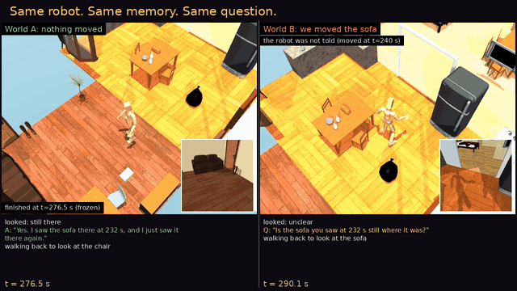
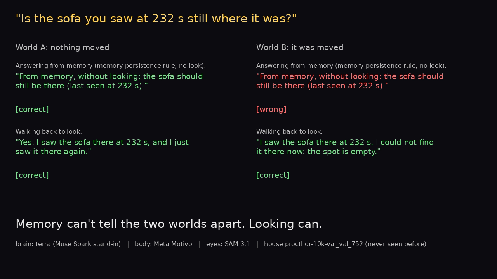

# Scout

### A physics-simulated home that tests whether a robot's memory is still true.



A Meta Motivo humanoid explores a house it has never seen. It sees through a head camera with SAM 3.1 and keeps a
memory of what it saw and where. Then the episode splits into two worlds. In one, nothing changes. In the other, we
quietly move an object. Both copies of the robot get the same question: *"Is the sofa you saw at 232 s still where
it was?"*



**Memory can't tell the two worlds apart. Looking can.** Answering from memory says "still there" in both worlds,
so it is wrong in one of them. The robot that walks back and looks gets both right: its depth camera now sees past
the spot where the sofa was.

Scout is an open environment for testing that ability in robot brains. Any model plugs in through four methods.
The environment runs the physics, the eyes and the hidden interventions, and scores every answer against what the
robot actually saw.

- **Physics, not animation.** The body is Meta Motivo in MuJoCo. It walks, falls and gets itself back up.
- **Its own eyes and map.** SAM 3.1 on an RGB-D head camera, and a floor map built from depth. No layout, no object
  list.
- **A world that changes behind its back.** Each episode branches from one physics snapshot into a moved world and
  an unchanged world, so both get the identical question.
- **Honest scoring.** Grading against per-frame visibility, frame-level citations, and abstentions counted
  separately. Every failure is kept.

| Part | Model / asset | Role |
| --- | --- | --- |
| Body | Meta Motivo M-1 (FB-CPR), SMPL humanoid in MuJoCo | walks, falls, gets back up |
| Eyes | SAM 3.1 (open weights, `facebook/sam3.1`) | open-vocabulary object masks on the head camera |
| Brain under test | GPT-6.1 Terra (stand-in for Muse Spark), Llama 4 Maverick, rules, random | when to re-check; which object a question is about; the answers |
| Worlds | ProcTHOR-10K houses from MolmoSpaces (CC BY 4.0), 800 train / 200 test | unseen homes |

## Built during the hackathon (Oct 27 - Nov 4, 2026)

The models and houses above were not built here. Everything else was.

- The body controller: blended Motivo skill vectors and fall recovery.
- The head RGB-D camera, and the floor map the agent builds from its own depth.
- SAM 3.1 placement of detections in 3D, and the episodic memory with confident and tentative objects.
- The brain interface.
- The evaluator: stable object ids, per-frame visibility, hidden interventions.
- The branched moved / unchanged episodes, the scorers, and the synchronised video renderer.

## What the agent gets (observation contract)

- **Head RGB-D:** 512×512, 75° vertical FOV, tilted 20° down. Depth is ideal simulated depth.
- **Pose:** the exact head-camera pose, and the body's position, heading and head height. This is perfect odometry
  from the simulator, and it is disclosed.
- **Detections:** SAM 3.1 detections for 16 object categories, once per second.
- **Actions:** Motivo skill vectors at 30 Hz. The built-in controller turns waypoints into skill blends.
- **The agent never sees:** the house layout, room labels, the object list, or any evaluator intervention.

Exploration uses a fixed rule (nearest reachable frontier on the agent's own map) for every brain. Brains decide
re-checks and answer questions. See `docs/environment.md` for the API, the tasks and the scoring rules.

## Run it

Full setup from scratch is in `docs/setup.md`: accounts, the house download, skill vectors and every command.

```bash
uv venv && uv pip install -e . modal boto3 pytest pillow "imageio[ffmpeg]"
.venv/bin/python -m pytest -q tests                      # CPU only: 74 tests, including six rounds of independent review
# score a real recorded episode without a GPU: see docs/setup.md section 5 (examples/sample_episode)
modal run scripts/modal_env.py::episode --house procthor-10k-val_val_935 --brain rules     # one episode, both arms (GPU)
modal run scripts/modal_env.py::compare --houses-file final2_houses.json --tag mytag      # frozen brain comparison
modal run scripts/modal_env.py::score --tag mytag                                        # leaderboard
modal run scripts/modal_env.py::videos --tag mytag                                       # synchronised videos
```

## License

MIT for this code; see `THIRD_PARTY.md` for the models and data (Meta Motivo is CC BY-NC 4.0).

## Results (final evaluation: 8 never-seen homes × 4 brains, 32 of 32 episodes)

- **Six clean verification pairs out of 32 episodes.** In each, the robot walked back, looked, and answered
  correctly in both worlds, while the memory-persistence rule was wrong in the moved one.
- **All 64 verification arms, counted:** 16 correct, 10 abstained, 16 wrong target (mostly the random brain),
  8 no answer in time, 14 not run (no eligible target). No arm checked the right object and gave the wrong
  verdict.
- **The memory-persistence rule was never right when the object had moved** (0 for every brain). The rule answers
  from memory without looking and calls no model, so this shows the stale-memory trap, not a model's judgement.
- **The memory quiz separates the brains.** It is graded only against what each robot's camera actually saw:
  - GPT-6.1 Terra (Muse Spark stand-in): 92/112 correct;
  - rules: 93/112;
  - Llama 4 Maverick: 48/96, with 16 invalid replies;
  - random: 16/96.
- **The body stays up:** 35 falls, and it got itself back up all 35 times.

Full leaderboard, every outcome category, provenance, retries and failures: `docs/results/environment_results.md`
and `docs/results/final3/`. Public videos and the records of all 32 episodes: `docs/evidence.md`.
